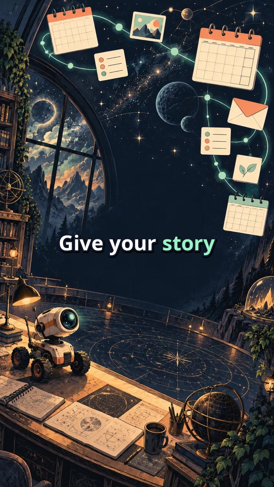

<p align="center"></p>

<h1 align="center">ReelKit</h1>
<p align="center"><strong>Short videos. Clear stories.</strong><br>Portable tools and agent guidance for illustrated reels with readable, centered captions.</p>
<p align="center"><a href="https://alexkubica.github.io/reelkit/">Website & demo</a> · <a href="#quickstart">Quickstart</a> · <a href="docs/schema.md">Project format</a> · <a href=".agents/skills/create-reel/SKILL.md">Agent skill</a></p>

[](https://alexkubica.github.io/reelkit/)

ReelKit turns a small JSON project, local illustrations, and optional narration into an H.264 MP4 and a separate SRT file. It is designed for humans and coding agents working on **macOS, Windows, or Linux**, including cloud containers with a Python runtime.

The included example renders **offline and without an API key**. It is intentionally silent. AI research, image generation, and speech are separate authoring steps; the renderer never contacts an online service.

## What it does

- Full-bleed illustrations with a gentle camera move, rather than repeated title-card layouts.
- Short caption phrases near the middle of the screen, with a stationary highlight on the spoken word.
- Hebrew and Latin text, including mixed Hebrew/English captions. Bundled open fonts avoid system-font differences.
- Supplied narration with precise word timings, or clearly approximate timing when none is supplied.
- A small CLI, an editable project format, an `AGENTS.md`, and a repository-scoped Codex skill.
- MP4/H.264 output, optional AAC narration, and UTF-8 SRT export.

There are no built-in whooshes, bouncing titles, paid accounts, Apple frameworks, or hidden uploads. This is an **early toolkit**, not a complete video editor: no automatic illustration generation, lip sync, music library, timeline GUI, or speech recognition is included.

## Quickstart

Use Python **3.9 or newer**; Python 3.11+ is recommended. Install from this repository; this project has not been published to PyPI.

```bash
git clone https://github.com/alexkubica/reelkit.git
cd reelkit
python -m venv .venv
```

Activate the environment:

| Shell | Command |
| --- | --- |
| macOS / Linux | `source .venv/bin/activate` |
| Windows PowerShell | `.venv\Scripts\Activate.ps1` |
| Windows Command Prompt | `.venv\Scripts\activate.bat` |

On systems where Python is named `python3`, use that command to create the environment. If PowerShell activation is restricted, invoke `.venv\Scripts\python.exe` directly instead of changing your system execution policy.

```bash
python -m pip install --upgrade pip
python -m pip install -e .
reelkit doctor
reelkit init my-reel
reelkit render my-reel/project.json --draft
```

The result is `my-reel/build/reel.mp4`, alongside `reel.srt`. Drop `--draft` for the project's full resolution. The draft caps the long edge at 640 pixels and the frame rate at 15.

For a Hebrew example:

```bash
reelkit init my-hebrew-reel --language he
reelkit render my-hebrew-reel/project.json --draft
```

FFmpeg comes from `imageio-ffmpeg` on supported platforms. Run `reelkit doctor` first. If your architecture has no bundled binary, install FFmpeg and set `IMAGEIO_FFMPEG_EXE` to its executable. No separate `ffprobe` is required.

## Make a reel

1. **Write a short story.** Start with a concrete question or hook. Keep factual claims sourced and separate them from jokes.
2. **Choose illustrations.** Use your own, licensed, or generated artwork. Give scenes distinct compositions and keep important faces and actions clear of the captions.
3. **Add speech if you want it.** Supply local audio and word timings, or explicitly invoke the optional online adapter below.
4. **Render a draft, inspect it, then export.** Check reading order, word timing, phone-size legibility, and the first and final frames.

Your project stays editable:

```json
{
  "version": 1,
  "title": "A tiny explainer",
  "width": 720,
  "height": 1280,
  "fps": 30,
  "caption": {"position": 0.5, "size": 52, "highlight": "#99f3c4"},
  "scenes": [
    {
      "id": "opening",
      "image": "images/opening.webp",
      "text": "A good question deserves a clear answer.",
      "phrases": ["A good question", "deserves a clear answer."],
      "duration": 4.0
    }
  ]
}
```

Paths are relative to the JSON file and must stay inside its directory. Rendering supports local images and audio, not remote URLs, executable templates, or playlists. See the [complete project format](docs/schema.md) for timings, options, and validation limits.

```bash
reelkit validate my-reel/project.json
reelkit render my-reel/project.json --output my-reel/build/final.mp4
```

## Optional online narration

Install the extra only if you want generated speech:

```bash
python -m pip install -e ".[voice]"
reelkit narrate my-hebrew-reel/project.json --voice he-IL-AvriNeural --rate +15%
reelkit render my-hebrew-reel/project.json
```

For English, select a compatible English voice, for example `en-US-AriaNeural`.

**This command sends the scene text to Microsoft's online speech service through the third-party `edge-tts` package.** It requires network access and is not an official Microsoft or OpenAI integration. Service availability, voice IDs, usage terms, and output rights are determined by that service; use your own audio when its terms do not fit your project. No provider key is required by this adapter, and no paid service is called automatically.

The command adds audio files under the project's `build/voice/` directory and updates the JSON with narration references and word timing. Provider boundaries are used when they align with the supplied text; otherwise timing is marked `estimated`. `--force` explicitly regenerates existing narration references. Original supplied audio files are preserved.

## Use with Codex or another agent

Open this repository in your agent and ask for a reel. Codex can discover [`.agents/skills/create-reel`](.agents/skills/create-reel/SKILL.md); other agents can read [`AGENTS.md`](AGENTS.md) and invoke the same CLI.

> Use the create-reel skill to make a 30-second illustrated explainer in Hebrew. Keep captions centered, vary the scene compositions, and use my supplied narration. Render a draft before the final export.

The skill documents a workflow, not an entitlement to tools. Image generation, connected accounts, network access, and available speech services depend on the host. If an agent cannot generate images, it can use supplied or licensed local assets; it should not pretend an unavailable capability exists.

## Across computers and cloud environments

The repository is the shared source of truth. Clone the same revision on each machine and install its dependencies. Keeping the files in Git makes the instructions portable; it does **not** synchronize installed tools, service connections, private assets, or runtime output.

| Environment | What it needs |
| --- | --- |
| macOS | Python, package dependencies; no Swift or AppKit |
| Windows | Python, package dependencies; PowerShell or Command Prompt |
| Linux / Codex cloud container | Python, package dependencies, an available FFmpeg binary, and writable output storage |
| Online speech authoring | The optional voice extra and permitted outbound network access |

Normal rendering works offline after installation. On hosts without RAQM, Hebrew/Latin captions use `python-bidi`; advanced shaping for other writing systems is not guaranteed. Emoji and unsupported scripts may require a custom font. Exact glyph rasterization can vary slightly by platform.

## Development

```bash
python -m pip install -e ".[dev]"
python -m pytest
python -m build
```

GitHub Actions runs the test suite, including a small real render, on Linux, macOS, and Windows. Tests cover narration alignment, silent gaps, RTL text, path containment, output integrity, and CLI behavior. Full-resolution rendering can take several minutes on a CPU; use drafts during iteration.

The website is plain HTML/CSS/JS in `docs/`. It has no build step, analytics, external fonts, or account integration. The included Pages workflow publishes that directory when GitHub Pages is configured to use GitHub Actions.

## Public-by-design

Only source, openly distributable fonts, original example illustrations, and the public demo belong in this repository. Local environments, credentials, generated speech, personal projects, and ordinary video outputs are ignored. Review both staged files and asset rights before publishing your own material. See [security](SECURITY.md), [contributing](CONTRIBUTING.md), and [asset provenance](src/reelkit/assets/demo/ASSETS.md).

Code and original example artwork: [MIT](LICENSE). Bundled Noto fonts: [SIL Open Font License](src/reelkit/assets/fonts/OFL.txt). Third-party services and FFmpeg distributions retain their own licenses and terms.
